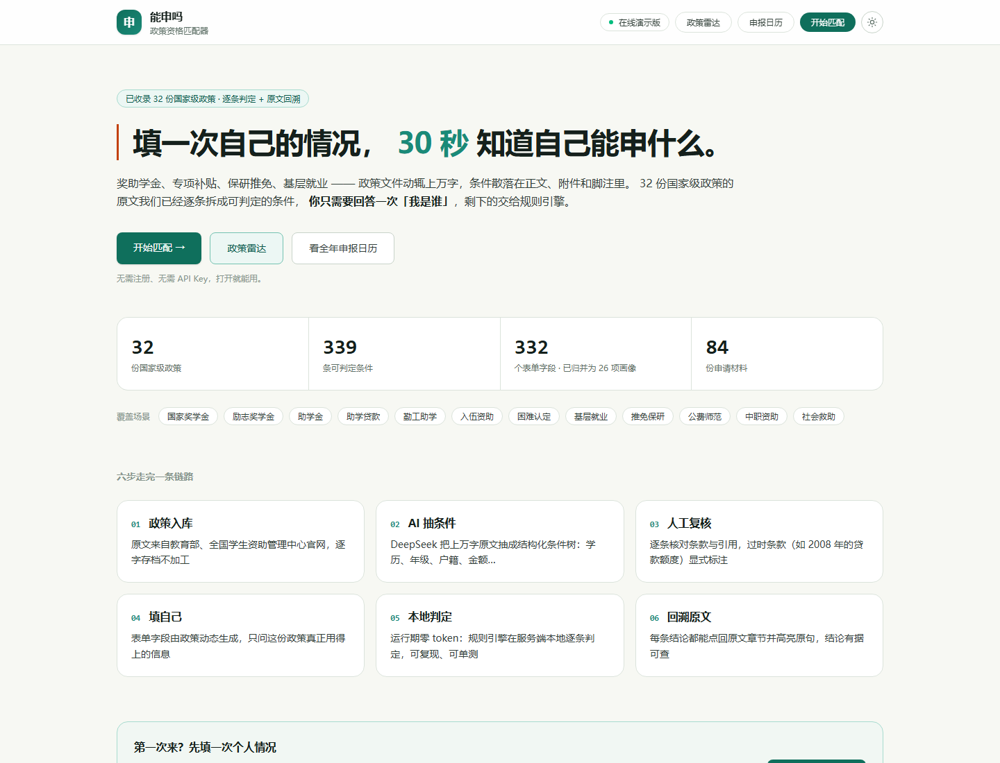
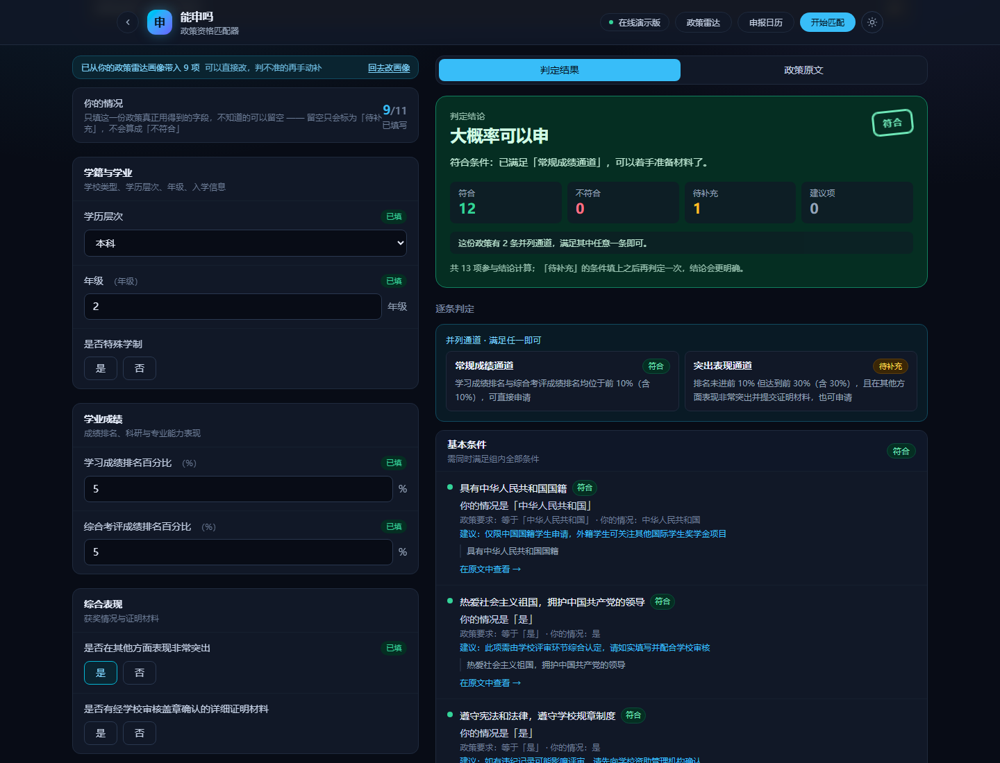
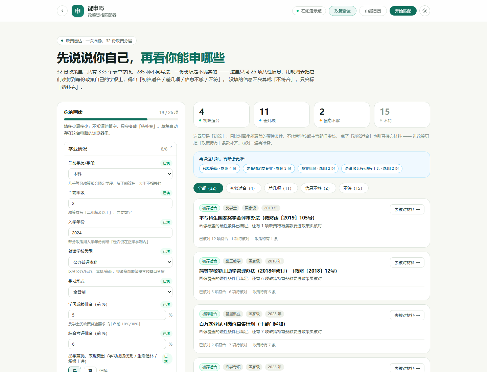

# 能申吗 · 政策资格匹配器

> **贴一份政策原文，30 秒知道自己够不够格。**
> 逐条判定 · 差在哪 · 缺什么材料 · 每条结论都能点回原文

[**在线演示**](https://someone227.github.io/shuanghuiwangzhongwang/) · [**技术文档（PDF · 30 页）**](./docs/能申吗-技术文档-v1.0.pdf) · [**评委快速验证**](#评委快速验证) · [**AI 协同记录**](./docs/ai-log/)



---

## 30 秒看懂

奖助学金、专项补贴、保研推免、人才落户 —— 这类政策文件动辄上万字，条件散落在正文、附件和脚注里。
用户真正的问题只有一个：**「我能申吗？」**

「能申吗」把这句话做成一条可验证的链路：

| | |
| --- | --- |
| **用户做什么** | 选一份政策，填一张只问关键项的表单（不知道的可以留空） |
| **系统做什么** | 用结构化条件树逐条比对，给出「符合 / 不符合（差在哪）/ 待补充」+ 理由 + 原文引用 + 材料清单 + 时间节点 |
| **结果长什么样** | 每条结论都能点回原文对应段落并高亮；结论只反映你填写的信息，最终以学校、主管部门审核为准 |

**它和「直接问 AI」的区别在哪？** 不是回答得好不好，而是三件结构上的事：

1. **可复现** —— 同一份填写、同一份政策，结论永远一样。大模型每次回答都可能不同，没法当依据。
2. **可追溯** —— 每条结论都指向原文的某一段、某一句话，而不是「模型觉得」。
3. **可担责** —— 拿到的是「你在第 7 条（二）上不满足」，而不是一段无法核对的自然语言。

所以我们的做法是：**用 AI 把十万字政策「编译」成条件树，用确定性引擎执行判定。**

---

## 关键数字

| 32 | 339 | 79 | 0 |
| --- | --- | --- | --- |
| 份国家级政策 | 条可判定条件 | 项自动化测试 | 运行期 token 消耗 |

| 指标 | 数值 |
| --- | --- |
| 政策原文 | 32 份 / 244 段落 / 10.2 万字，逐字存档可 diff |
| 结构化产出 | 146 个条件组 · 339 条条件 · 332 个字段 · 84 项材料 · 60 个时间节点 |
| 政策雷达 | 332 个字段归并为 26 项共性画像，一次填写横判 32 份政策 |
| AI 调用 | 仅建库期 37 次（32 份政策，5 份重试），合计 219,952 token，平均 12.8 秒/份 |
| 判定引擎 | `server/src/domain/matcher.ts` 375 行纯函数，支持 10 种操作符与字段间比较 |
| 工程质量 | 79 个测试（9 个测试文件）· 前后端 typecheck · 68 次细粒度提交（4 天） |
| 部署形态 | 双形态：服务端版（账号体系）+ GitHub Pages 纯静态版（零后端、断网可用） |

---

## 一条链路：从政策原文到个人结论

```
政策原文（官网抓取、逐字存档）
   ↓  清洗站点导航与页脚噪声，重算段落偏移
DeepSeek 抽取（JSON Output · temperature 0 · 只做一次）
   ↓  三道闸门：JSON 协议层 → 结构校验 → 带错重试修正
人工复核（57 条改动留痕在每份政策的 review 字段里）
   ↓  过时条款标注【现行标准】，不混进条件树
条件树 JSON（随仓库提交，和代码同版本、可 diff）
   ↓
用户填表（不知道的留空 → 记为「待补充」，不误判「不符合」）
   ↓
本地确定性引擎逐条判定（零 token、可离线、结果确定）
   ↓
符合 / 不符合（差在哪）/ 待补充 + 原文回链高亮 + 材料清单 + 时间节点
```

各步骤的细节、时序图、失败降级路径见 [技术文档 第 3 章](./docs/能申吗-技术文档-v1.0.pdf)。

---

## 核心设计：大模型只在「建库」这一步用一次

这是本项目和「接个聊天框套壳」最大的区别：

| 阶段 | 谁在干活 | 是否消耗 token |
| --- | --- | --- |
| 开发期（建库） | DeepSeek 把政策原文抽取成条件树 JSON，人工逐条复核 | 一次性，每份政策约 1 次调用 |
| 运行期（判定） | 本地确定性引擎（纯函数）按条件树逐条比对 | **零 token，断网也能跑** |

这样设计的原因：

1. **现场演示不烧钱**：任何人克隆仓库、不配 Key 就能完整跑通判定（政策库已随仓库提交）。
2. **可复现、可测试**：判定结果只由「条件树 + 用户输入」决定，79 个测试覆盖判定引擎、并列通道、政策库数据契约、政策雷达、申报日历与账号体系。
3. **可解释、可追溯**：每条条件都带原文段落引用（`docRef` + `quote`），测试断言每句 quote 都能在原文中逐字找到 —— 大模型没有编造条款的空间。
4. **过时条款不当成有效条件**：政策原文里的历史金额、试点省份等已失效条款不参与判定，页面顶部显式提示现行标准（如助学贷款额度此后已多次上调），不假装它还有效。

**AI 用在哪些环节、怎么控住它**，见 [技术文档 第 4 章](./docs/能申吗-技术文档-v1.0.pdf)：9 条系统提示词各自防什么失败模式、三道闸门的实际拦截情况、37 次调用的完整留痕（[docs/ai-log/](./docs/ai-log/)）。

---

## 界面

**逐条判定（深色主题）** —— 左侧填情况，右侧逐条结论、并列通道、原文引用，右上角是结论印章：



**政策雷达（浅色主题）** —— 填一次 26 项画像，32 份政策分四层：



同一套组件支持两套配色，顶栏右侧随时切换。颜色全部收敛成 CSS 变量，组件只写语义类名（`bg-surface` / `text-ink` / `border-line`），深色模式不维护第二套组件。

---

## 判定口径（容易误解的地方）

- **留空不等于不符合**：没填的条件只记「待补充」，结论停在「还不能下结论」，不会把空缺当成「不满足」。
- **并列通道是「任选其一」**：国家奖学金有「常规成绩通道」与「突出表现通道」，满足任意一条即可。判定页与政策详情页都会把通道单独列出来，不会把两条通道的要求叠加。
- **雷达的四层只是初筛**：「初筛适合 / 差几项 / 信息不够 / 不符」只比对 26 项画像能覆盖的硬性条件，政策特有条款仍要进政策页核对 —— 页面和结果卡上都写明了这一点，初筛适合不等于可以直接交材料。
- **日历标了责任方**：「个人要办」才是需要自己动手的，学校与主管部门的节点只是流程进度；往年已截止的一次性节点沉到「政策沿革」，不混进今年的待办。
- **判定不代替审核**：结论只反映你填写的信息，最终是否通过以学校、主管部门审核为准。

---

## 功能与页面

八个路由，覆盖「找政策 → 看条件 → 判自己 → 什么时候办」的完整闭环：

| 路径 | 页面 | 做什么 |
| --- | --- | --- |
| `/` | 首页 | 产品说明、政策库统计、六步链路 |
| `/policies` | 政策库 | 32 份政策卡片，按类别筛选 + 关键词搜索（含原文命中） |
| `/policies/:id` | 政策详情 | 单份政策的完整档案：条件组逐条（含原文引用）、材料清单、时间节点、分段原文、同类政策推荐 |
| `/match/:id` | 判定页 | 左侧填情况、右侧逐条判定，可切换到原文对照并高亮命中段落；支持从雷达画像一键带入 |
| `/radar` | 政策雷达 | 填一次 26 项共性信息，一次性看 32 份政策分成「初筛适合 / 差几项 / 信息不够 / 不符」 |
| `/calendar` | 申报日历 | 把 60 个时间节点摊到 12 个月，每条标注「个人要办 / 学校/院系 / 主管部门」，可只看个人要办的 |
| `/login`、`/account` | 账号与个人中心 | 注册登录；个人中心汇总判定次数、覆盖政策、填到一半的政策、画像与资格概览，并可一键清空数据 |

---

## 评委快速验证

**方式一：直接打开在线演示（零安装、零配置）**

<https://someone227.github.io/shuanghuiwangzhongwang/>

纯静态版：政策 JSON 静态化 + 判定引擎打包进浏览器，**不需要后端、不需要 API Key、断网也能判定**。
静态版没有账号体系（登录与个人中心需要后端），其余功能完全一致。

<details>
<summary>静态版怎么构建与发布（三步）</summary>

```bash
node server/scripts/export-static-data.mjs   # 导出政策 JSON 到 web/public/policy-data/
pnpm --filter web run build:pages            # pages 模式构建（base=/shuanghuiwangzhongwang/）
node tools/deploy-pages.mjs                  # 发布到 gh-pages 分支
```

</details>

**方式二：本地跑完整版（含账号体系）**

> 前置：Node.js ≥ 20.19、pnpm ≥ 9

```bash
pnpm install
pnpm dev          # 前端 http://localhost:5173 · 后端 http://localhost:8787
```

**不配置 API Key 也能完整使用**：政策库已随仓库提交，判定全部在本地完成。只有需要重新抽取政策时才需要 Key。

**演示账号**（登录页左侧有「一键填入」按钮）：

| 账号 | 密码 |
| --- | --- |
| `demo` | `NengShenMa2026` |

- 账号与**判定记录**都存在服务端（`data/users.json`、`data/user-data.json`）：换一台电脑用同一账号登录，历史判定仍在。
- **填写的内容不会被保存**：判定页表单只存在当前页面内存里，离开或刷新即清空，浏览器本地与服务端都不留填报内容（填的是家庭经济、成绩排名这类个人信息）。
- **不登录也能完整使用判定功能**，登录只用于多设备共享判定记录。
- 同一局域网的其他电脑访问：用 `pnpm dev` 启动后访问 `http://<本机内网IP>:5173` 即可。

**方式三：跑测试（验证引擎真的在算）**

```bash
pnpm test         # 79 个测试：判定引擎、并列通道、政策库数据契约、原文回溯、雷达、日历、账号
pnpm typecheck    # 前后端类型检查
pnpm build        # 前端生产构建
```

---

## 已收录政策

32 份全国性政策（来源：教育部、全国学生资助管理中心、中国政府网、民政部，均为国家级文件，不含地方或校级细则；原文存档于 `data/policies/raw/`，逐字未加工）。

<details>
<summary>展开 32 份政策清单与判定条件数</summary>

| 政策 | 发文字号 | 类别 | 判定条件 |
| --- | --- | --- | --- |
| 本专科生国家奖学金评审办法 | 教财函〔2019〕105号 | 奖学金 | 13 |
| 普通本科高校、高等职业学校国家励志奖学金管理暂行办法 | 财教〔2007〕91号 | 奖学金 | 12 |
| 研究生国家奖学金管理暂行办法 | 财教〔2012〕342号 | 奖学金 | 8 |
| 研究生学业奖学金管理暂行办法 | 财教〔2013〕219号 | 奖学金 | 9 |
| 普通本科高校、高等职业学校国家助学金管理暂行办法 | 财教〔2007〕92号 | 助学金 | 9 |
| 研究生国家助学金管理暂行办法 | 财教〔2013〕220号 | 助学金 | 7 |
| 财政部 教育部 银监会关于大力开展生源地信用助学贷款的通知 | 财教〔2008〕196号 | 助学贷款 | 9 |
| 高等学校勤工助学管理办法（2018年修订） | 教财〔2018〕12号 | 勤工助学 | 11 |
| 高等学校学生应征入伍服义务兵役国家资助办法 | 财教〔2013〕236号 | 入伍资助 | 9 |
| 退役士兵教育培训工作指导意见 | 退役军人部发〔2021〕53号 | 入伍资助 | 21 |
| 教育部等六部门关于做好家庭经济困难学生认定工作的指导意见 | 教财〔2018〕16号 | 困难认定 | 8 |
| 高等学校毕业生学费和国家助学贷款代偿暂行办法 | 财教〔2009〕15号 | 基层就业 | 12 |
| 高校毕业生「三支一扶」计划 | 人社厅发〔2025〕21号 | 基层就业 | 6 |
| 百万就业见习岗位募集计划 | 十部门联合通知 | 基层就业 | 9 |
| 全国普通高等学校推荐优秀应届本科毕业生免试攻读硕士学位研究生工作管理办法（试行） | 教学〔2006〕14号 | 推免保研 | 14 |
| 教育部直属师范大学本研衔接师范生公费教育实施办法 | 国办发〔2024〕27号 | 升学专项 | 16 |
| 中西部农村订单定向免费本科医学生招生培养 | 教高厅函〔2023〕10号 | 升学专项 | 9 |
| 培养少数民族高层次骨干人才计划的实施方案 | 教民〔2005〕11号 | 升学专项 | 16 |
| 关于逐步推行免费学前教育的意见 | 国办发〔2025〕27号 | 学前教育 | 4 |
| 义务教育阶段家庭经济困难学生生活补助 | 教财厅函〔2019〕20号 | 义务教育 | 5 |
| 农村义务教育学生营养改善计划 | 财教〔2021〕174号 | 义务教育 | 6 |
| 城乡义务教育教科书免费提供 | 教财〔2017〕1号 | 义务教育 | 6 |
| 普通高中家庭经济困难学生国家资助制度 | 财教〔2010〕356号 | 普通高中 | 6 |
| 普通高中建档立卡家庭经济困难学生免除学杂费 | 教财厅〔2016〕4号 | 普通高中 | 7 |
| 中等职业教育国家奖学金评审办法 | 教财〔2023〕11号 | 中职资助 | 13 |
| 中等职业学校国家助学金管理办法 | 财科教〔2016〕35号 | 中职资助 | 8 |
| 中等职业学校学生资助工作指南 | 教财厅函〔2020〕8号 | 中职资助 | 10 |
| 最低生活保障审核确认办法 | 民发〔2021〕57号 | 社会救助 | 13 |
| 特困人员认定办法 | 民发〔2021〕43号 | 社会救助 | 17 |
| 困难残疾人生活补贴和重度残疾人护理补贴制度 | 民发〔2021〕70号 | 社会救助 | 12 |
| 事实无人抚养儿童保障 | 民发〔2019〕62号 | 社会救助 | 23 |
| 国务院关于全面建立临时救助制度的通知 | 国发〔2014〕47号 | 社会救助 | 11 |

</details>

---

## 数据来源、时效性与边界（我们会主动说清楚的局限）

| 项目 | 说明 |
| --- | --- |
| 数据来源 | 政策原文全部来自教育部、全国学生资助管理中心、中国政府网、民政部等官方站点，`sourceUrl` 字段挂在每份政策上，可逐条核对 |
| 时效性 | 只收国家级文件，不含地方/校级细则；原文里的历史金额与试点范围不参与判定，改写进 `notes` 的【现行标准】提示（如国家奖学金 8000 → 10000 元/年，财教〔2024〕181号） |
| 覆盖范围 | 32 份政策、14 个类别；不是全部资助政策，是「足够覆盖大学生常见场景」的一个集合 |
| 判定边界 | 结论只反映用户填写的信息，不代替学校与主管部门审核；留空记「待补充」，不猜测 |
| AI 边界 | 大模型只参与建库期抽取，运行期零调用；抽取结果经过结构校验与人工复核，但**不宣称「判定准确率 100%」** —— 我们提供的是「79 项测试覆盖边界 + 339 条条件全部可回溯原文」 |
| 隐私 | 政策数据公开；用户填报的敏感信息（家庭经济、成绩排名）不落库、不上传；账号只存用户名哈希与判定记录摘要 |

完整的数据清洗、过时条款处理与风险清单见 [技术文档 第 5 章](./docs/能申吗-技术文档-v1.0.pdf)。

---

## 技术栈与架构

| 层 | 选型 | 关键点 |
| --- | --- | --- |
| 前端 | Vue 3 + Vite 6 + TypeScript + Tailwind CSS v4 | SPA 路由 + 组合式 API；Tailwind v4 的 `@theme` 让双主题只靠 CSS 变量切换 |
| 后端 | Node.js + Express 4 + TypeScript（tsx 直跑） | 20 个 `/api/*` 端点；无数据库、无运行期外部依赖 |
| 政策数据 | JSON 条件树（`data/policies/`） | 32 份政策随仓库提交，和代码同版本、可 diff、可回滚 |
| 判定引擎 | `server/src/domain/matcher.ts`（375 行纯函数） | 10 种操作符 + 字段间模板比较；同一套代码在 Node 与浏览器里跑 |
| 大模型 | DeepSeek `deepseek-chat`（JSON Output，temperature 0） | 只在建库期调用，37 次完整留痕 |
| 账号体系 | 服务端 JSON + scrypt 密码哈希 + 无状态 HMAC-SHA256 令牌 | 不引入数据库与会话表，重启不掉线 |
| 测试 | `tsx --test`（Node 内置 test runner） | 79 个用例，零额外依赖 |
| 部署 | Express 服务端模式 + GitHub Pages 纯静态模式 | `tools/deploy-pages.mjs` 走 REST API 发布，不依赖 CI |

> 关于「为什么不用数据库 / 不用向量库 / 不用多 Agent」：判定这件事需要的是确定性，不是自由度。详见技术文档 2.2 节的选型理由。

---

## 工程质量与开发过程

**细粒度提交**：4 天 68 次提交，每次对应一个功能模块或一次 AI 对话，提交信息写清「改了什么 + 为什么 + 怎么验证」。里程碑：

| 里程碑 | 内容 |
| --- | --- |
| M1 骨架与引擎 | 前后端骨架、条件树领域模型、本地判定引擎、5 份政策入库 |
| M2 政策库扩充 | 32 份政策、动态表单、逐条判定页、原文回链 |
| M3 账号与静态化 | 注册登录、跨设备判定记录、纯静态部署上线 |
| M4 横向能力 | 政策雷达、申报日历、政策详情页、双主题 |
| M5 打磨与纠偏 | 搜索重构、判定缺陷修复、全站动效与可访问性 |

**AI 协同留痕**：`docs/ai-log/policies/*.json`（32 份）保存每次抽取的完整 messages、响应与 token 用量（不含请求头与 Key），可复现每一次抽取；人工复核的 57 条改动记录在每份政策的 `review` 字段里。

**质量门**：`pnpm test`（79 项）+ 前后端 `typecheck` + 构建 + 无头浏览器逐页截图核对，每次改动都跑一遍。

---

## 参赛材料对照

第九届「传智杯」全国大学生计算机大赛 · AI-WEB 赛道（团队赛 · B 组）

| 比赛要求 | 状态 | 位置 |
| --- | --- | --- |
| 代码仓库公开可访问 | ✅ | <https://github.com/Someone227/shuanghuiwangzhongwang> |
| README 与运行/环境配置说明 | ✅ | 本文件「评委快速验证」「环境变量」 |
| 完整、细粒度的 Git 提交历史 | ✅ | 68 次提交，4 天，见 `git log` |
| 技术文档 PDF ≤ 30 页（含架构图、时序图、AI 调用链路、数据来源与风险） | ✅ | [docs/能申吗-技术文档-v1.0.pdf](./docs/能申吗-技术文档-v1.0.pdf)（A4 · 30 页） |
| AI 协同过程证据 | ✅ | [docs/ai-log/](./docs/ai-log/)、`review` 复核记录 |
| API Key 不入库 | ✅ | `.env` 已被 `.gitignore` 排除，仓库只提供 `.env.example` |
| 公网在线演示（加分项） | ✅ | <https://someone227.github.io/shuanghuiwangzhongwang/> |
| 演示视频 5–8 分钟 · 1080p · 普通话 | ⏳ 制作中 | — |

技术文档源文件在 `docs/tech-report/`（HTML 章节 + 构建脚本），可重新生成 PDF。

---

## 目录结构

```
.
├── web/                          # 前端（Vue 3 + Vite）
│   ├── src/
│   │   ├── views/                # 首页 / 政策库 / 详情 / 判定 / 雷达 / 日历 / 登录 / 个人中心
│   │   ├── components/           # 动态表单、判定报告、原文对照
│   │   ├── lib/                  # API 封装、登录态、字段分组、结论样式、主题
│   │   └── router/
│   └── public/
├── server/                       # 后端（Express + TypeScript）
│   ├── src/
│   │   ├── domain/               # 条件树类型、判定引擎、雷达、日历、检索及其测试
│   │   ├── policies/             # 读取 data/policies 的存储层
│   │   ├── auth/                 # 密码哈希、账号存储、令牌签发、鉴权中间件
│   │   ├── userdata/             # 按账号保存判定记录与填报进度
│   │   └── routes/               # /api/policies、/api/radar、/api/calendar、/api/auth、/api/me
│   └── scripts/                  # 抽取、清洗、偏移修复、静态数据导出
├── data/policies/                # 政策原文（raw/）与条件树 JSON，随仓库提交
├── docs/
│   ├── ai-log/                   # AI 协同记录（每次抽取的请求 / 响应 / 用量）
│   ├── screenshots/              # README 截图
│   ├── tech-report/              # 技术文档源文件与构建脚本
│   └── 能申吗-技术文档-v1.0.pdf   # 技术文档成品（30 页）
├── tools/
│   ├── deploy-pages.mjs          # 把 web/dist 发布到 gh-pages
│   └── git-sync.mjs              # 网络受限时的备用同步工具
└── AGENTS.md                     # 项目协作与版本管理约定
```

---

## 环境变量

复制 `.env.example` 为 `.env`（**真实 `.env` 已被 `.gitignore` 排除，绝不入库**）。仅重新抽取政策时才需要填写 Key。

| 变量 | 说明 |
| --- | --- |
| `PORT` | 后端端口，默认 8787 |
| `DEEPSEEK_API_KEY` | DeepSeek API Key（只在运行抽取脚本时需要） |
| `DEEPSEEK_BASE_URL` | 默认 `https://api.deepseek.com` |
| `DEEPSEEK_MODEL_CHAT` | 默认 `deepseek-chat` |
| `DEMO_ACCOUNT_PASSWORD` | 演示账号 `demo` 的密码，默认 `NengShenMa2026` |
| `AUTH_SECRET` | 登录令牌签名密钥；不填则首次启动自动生成 `data/.auth-secret` |
| `USERS_FILE` / `USERDATA_FILE` | 账号与个人数据文件路径 |

---

## 开发约定与团队分工

开发约定见 [AGENTS.md](./AGENTS.md)：重大更改必须提交并同步 GitHub、细粒度提交、`main` 始终可运行、API Key 只放 `.env`、每次 AI 协作留痕。

| 角色 | 负责 |
| --- | --- |
| 前端 | 页面、交互、可视化、双主题与动效 |
| 后端 / AI 集成 | 数据模型、判定引擎、接口、Prompt 与调用链路 |
| UI 与文档 | 视觉规范、技术文档、演示视频 |

---

<div align="center">
<sub>能申吗 · 第九届传智杯 AI-WEB 赛道参赛作品 · Vue 3 · Vite · Tailwind · Express · DeepSeek</sub>
</div>
